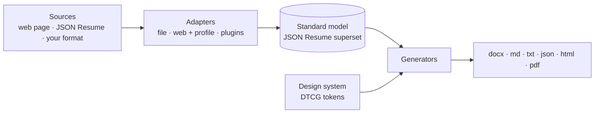

# cv-gen

Generate a CV from wherever your career already lives — a personal website, a JSON Resume
file, an export — in every format you're asked for: Word, Markdown, plain text, JSON, HTML
and PDF. Edit the source; rebuild the CV.



- **Pluggable sources.** An adapter turns one source into the standard model. Built in:
  `file` (JSON Resume or YAML) and `web`, a generic engine that reads any page through a
  declarative YAML profile of CSS selectors, so most sites need no code at all. Add your
  own as an installed plugin or a plain module on a plugin path.
- **One model, every format.** The model is [JSON Resume](https://jsonresume.org) plus a few
  extensions, so the JSON output works with JSON Resume tools. Word documents use real
  heading styles and no tables, which applicant-tracking systems parse reliably; Markdown
  uses real heading levels; text is wrapped and plain.
- **Designed by tokens.** HTML and PDF (and Word's fonts and accent) are styled by a design
  system in the W3C [Design Tokens](https://www.designtokens.org/) format, from a file or a
  pinned URL. Token values are validated, so a design system can't inject anything into the
  page.
- **Safe by default.** Source text is escaped everywhere; a configurable guard refuses to
  write any CV that contains a forbidden word.

## Install

Python 3.11 or later.

```sh
pip install cv-gen                       # or: uv tool install cv-gen
pip install "cv-gen[playwright]"          # optional PDF engine for machines without Chrome/Edge
```

From a checkout: `uv sync`, then prefix commands with `uv run`.

PDF output prints the HTML page with an installed Chrome, Edge or Chromium (Edge ships with
Windows), or with the optional Playwright or WeasyPrint engines.

## Quick start

```sh
cp cv-gen.config.example.yaml cv-gen.config.yaml   # your copy is git-ignored
cv-gen build                                        # the fictional sample, every format, in out/
```

Then point the config at your own source:

```yaml
sources:
  - adapter: web
    options:
      profile: profiles/my-site.yaml      # docs/web-profiles.md
      url: https://me.example/about
  - adapter: file                         # private details the site doesn't publish
    options: {path: private-overlay.local.yaml}
design: examples/designs/serif.tokens.json
```

Or skip the config entirely:

```sh
cv-gen build -a file -o path=resume.json -f pdf -f docx --out out/
cv-gen extract -a web -o profile=my-site.yaml -o url=https://me.example/about   # see the data
```

## Keeping personal things private

The repository holds only generic code. Personal pieces live outside it:

- `cv-gen.config.yaml` and `*.local.yaml` are git-ignored; `cv-gen.config.example.yaml`
  is the committed template.
- A site-specific profile, transforms or adapter can live in its own private package or
  repository, checked out beside or inside this one (git-ignored), and be loaded through
  `plugins.paths` or installed with an entry point. See [docs/adapters.md](docs/adapters.md).

## Documentation

| Guide | |
|---|---|
| [Configuration](docs/configuration.md) | Every config key, source merging, sections, the guard |
| [Command reference](docs/cli.md) | `build`, `extract`, `render`, `validate`, `schema`, `formats`, `adapters`, `design` |
| [Writing an adapter](docs/adapters.md) | The adapter contract, registration, testing; with a [working example](examples/adapter-example) |
| [Web profiles](docs/web-profiles.md) | Extracting any page with CSS selectors and transforms |
| [Design tokens](docs/design-tokens.md) | The tokens cv-gen reads, value formats, custom CSS, templates |
| [The model](docs/model.md) | The JSON Resume superset every adapter produces |

## Development

```sh
uv sync                     # installs dev tools and the example adapter
uv run pytest               # the suite, with coverage; runs offline
uv run ruff check . && uv run ruff format --check .
```

The browser PDF test is skipped when no Chromium-family browser is installed.

## License

MIT
