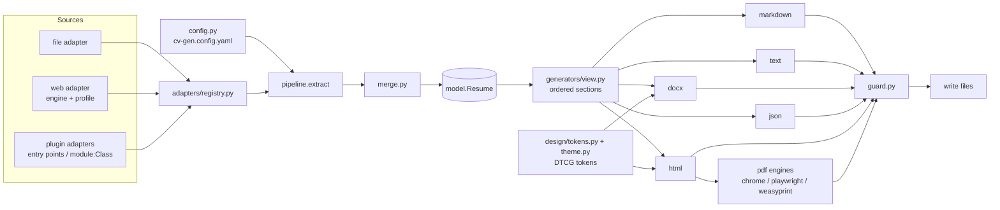
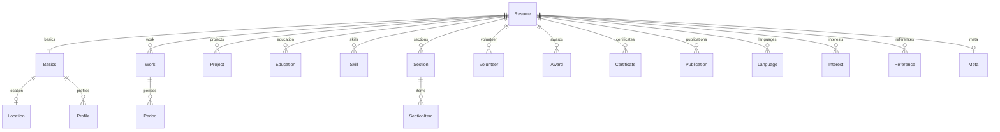

# cv-gen Design

## Summary

A pipeline of three swappable stages around one Pydantic model. **Adapters** turn a source into a `Resume`; a **merger** layers several sources; **generators** turn a `Resume` into bytes for one format each, through a shared section view so every format orders, titles and omits sections the same way. HTML and PDF read a **theme** compiled from DTCG design tokens. The CLI is a thin layer over `pipeline.extract()` and `pipeline.render()`, and nothing is written to disk until every output has been rendered and passed the guard.

## Architecture



Package layout (`src/cv_gen/`):

| Module | Role |
|---|---|
| `model.py` | The `Resume` model and its parts; `PartialDate` type |
| `errors.py` | `CvGenError(message, hint)`; pretty formatting of Pydantic errors |
| `config.py` | Config models, `load_config(path)`, path resolution |
| `merge.py` | `deep_merge(base, overlay, mode)` |
| `pipeline.py` | `extract(sources, ctx) -> Resume`, `render(resume, request) -> list[Output]`, `write(outputs, dir)` |
| `adapters/base.py` | `Adapter`, `AdapterOptions`, `AdapterContext` |
| `adapters/registry.py` | Built-ins, entry points, `module:Class`, plugin paths |
| `adapters/file.py` | JSON/YAML in the standard model |
| `adapters/web/` | `adapter.py`, `profile.py` (profile models), `engine.py` (selector evaluation), `transforms.py` (registry + built-ins), `dates.py`, `jsonld.py`, `fetch.py` |
| `generators/` | `base.py` (registry, `Generator`), `view.py`, `markdown.py`, `text.py`, `docx.py`, `jsonout.py`, `html.py`, `pdf.py`, `templates/*.j2` |
| `design/` | `tokens.py` (DTCG load, flatten, aliases), `theme.py` (semantic tokens, validation, CSS), `default.tokens.json` |
| `pdf/engines.py` | `PdfEngine` interface and the three engines |
| `guard.py` | Forbidden-term scan |
| `console.py` | UTF-8 console setup |
| `cli.py` | Typer app |

Outside the package: `examples/adapter-example/` (standalone package `cv-gen-example-adapter`, a dev dependency through a uv path source so its entry point is live in the dev environment), `examples/sample-resume.yaml` and `examples/profiles/` (a fictional person and a generic web profile), `docs/`, `tests/`, and the git-ignored `cv-gen-corey/` (its own repository).

## Key design decisions

1. **The model is JSON Resume plus a few extensions, with `extra="allow"`.** Unknown keys from other JSON Resume tools survive a round trip; generators ignore them. The extensions (`headline`, `periods`, `tags`, `sections`) are the minimum the coreystruzan.com page and similar "about" pages need. *Alternative:* a strict bespoke model; it would lose interoperability for nothing.
2. **Profiles are data, transforms are code.** A web profile (YAML) only names selectors and transform names; anything that needs logic is a named transform, built-in or registered from a module the profile names. This keeps the engine generic (REQ-4) and puts the only site-specific code in a plugin (REQ-13).
3. **The `"."` target merges a dict into the current record.** One source element sometimes yields several fields (a date range yields `startDate`, `endDate` and `periods`; "Founder. Game studio…" yields `position` and `summary`). Transforms that return a mapping are applied with the target `"."`. *Alternative:* multi-target syntax; harder to read.
4. **Render in memory, then guard, then write.** Generators return bytes. PDF rendering writes its HTML to a temporary folder only. The guard sees every output before any file exists, so a guard failure writes nothing (14.0.2), while a missing PDF engine is a per-format failure: the other outputs are still written and the command exits non-zero (8.0.4).
5. **One section view for every generator.** `view.sections(resume, options)` returns ordered `ViewSection(id, title, kind, payload)` objects, skipping empty ones. Ordering, titles and omission (6.0.4, 6.0.5) are implemented once.
6. **Tokens become CSS only through typed validators.** Each semantic token has a type; its value is parsed by that type's validator and re-serialized, so the CSS contains only what the validator produced, never the raw string (9.0.3). Custom CSS and font imports come only from local design files (9.0.5).
7. **The `chrome` engine shells out to a browser rather than pulling in Playwright.** Zero install on most machines; Playwright stays optional for headless servers.
8. **Paths in options are resolved by the adapter through its context.** `AdapterContext.base_dir` is the config file's folder (or the working directory for CLI-only runs); `ctx.resolve(path)` keeps relative-path behavior uniform (10.0.2) without the config layer knowing each adapter's options.
9. **Option overrides from the CLI are YAML scalars.** `--option timeout=5` gives an int, `--option url=https://…` a string, so options models validate them as they would config values.

## Data model



- `Basics`: `name`, `label`, `headline`*, `image`, `email`, `phone`, `url`, `summary`, `location` (`address`, `postalCode`, `city`, `countryCode`, `region`), `profiles` (`network`, `username`, `url`).
- `Work`: `name`, `position`, `url`, `location`, `description`, `startDate`, `endDate`, `periods`* (`startDate`, `endDate`), `summary`, `highlights`, `tags`*. `Project` gains `periods`* and `tags`* the same way.
- `Section`*: `id` (slug, unique, not a built-in section id), `title`, `updated` (partial date), `paragraphs: list[str]`, `items: list[SectionItem(title, subtitle, text, url, date)]`.
- `Meta`: `canonical`, `version`, `lastModified`, `sources`* (adapter names and locations that produced the document).
- `PartialDate`: `^\d{4}(-(0[1-9]|1[0-2])(-(0[1-9]|[12]\d|3[01]))?)?$`.

\* extension field.

**Web profile** (YAML):

```yaml
name: generic-about           # informational
url: https://example.com/about  # default source; adapter options override
jsonld: true                  # read schema.org Person into basics first
exclude: [".only-phone"]      # removed before extraction
transforms_module: my_pkg.transforms   # optional
fields:                       # target path -> spec, or a list of specs to concatenate
  basics.headline: { selector: "h1", required: true }
  work:
    each: "ol.timeline > li"  # one record per match
    fields:
      name: { selector: ".org" }
      ".": { selector: ".dates", transforms: [date_range] }
      tags: { attr: data-kind, transforms: [as_list] }
```

A field spec: `selector` (relative to the current scope; omitted means the scope itself), `attr`, `extract` (`text` default, `attr`, `json`, `html`), `all` (list of every match), `drop` (selectors removed from the matched element's copy before reading it), `transforms` (names, or `{name: args}`), `required`, `value` (a constant), `each` + `fields` (a list of records), `default`.

**Design system**: a DTCG document. Consumed tokens, each with a type and a default:

| Token | Type | Default |
|---|---|---|
| `color.text`, `color.muted`, `color.heading`, `color.accent`, `color.link`, `color.background`, `color.rule` | color | `#1f2328`, `#57606a`, `#1f2328`, `#0b5cad`, `#0b5cad`, `#ffffff`, `#d0d7de` |
| `font.body`, `font.heading`, `font.mono` | fontFamily | system stacks |
| `font-size.base`, `font-size.small`, `font-size.name`, `font-size.section`, `font-size.entry` | dimension | `10.5pt`, `9pt`, `22pt`, `12pt`, `10.5pt` |
| `font-weight.heading` | fontWeight | `700` |
| `line-height.base` | number | `1.4` |
| `space.section`, `space.entry` | dimension | `14pt`, `8pt` |
| `rule.width` | dimension | `1px` |
| `page.size` | string (`A4`, `A5`, `Letter`, `Legal`, or two dimensions) | `Letter` |
| `page.margin` | dimension | `0.6in` |

Root `$extensions["com.cv-gen"]`: `customCss` (path, local only), `fontImports` (https URLs, local only). Color values accept hex, `rgb()`/`hsl()` and the DTCG object form (`colorSpace: srgb`, `components`, `alpha`, `hex`); dimensions accept `"12pt"` and `{value, unit}`.

## Interfaces

```python
class AdapterOptions(pydantic.BaseModel):            # extra="forbid"
    ...

class AdapterContext:
    base_dir: Path
    def resolve(self, path: str | Path) -> Path: ...

class Adapter(abc.ABC):
    name: ClassVar[str]
    description: ClassVar[str]
    Options: ClassVar[type[AdapterOptions]]
    @abc.abstractmethod
    def extract(self, options: AdapterOptions, ctx: AdapterContext) -> Resume: ...

# registry
def available_adapters() -> dict[str, type[Adapter]]
def resolve_adapter(ref: str) -> type[Adapter]        # name or "module:Class"
def add_plugin_paths(paths: Iterable[Path]) -> None

# web transforms
TransformFn = Callable[[Any, TransformContext, ...], Any]   # value in, value out
def transform(name: str) -> Callable[[TransformFn], TransformFn]   # decorator
def register_module(module_name: str) -> None         # imports it; its @transform calls register

# generators
class Generator(Protocol):
    name: str; extension: str; binary: bool
    def render(self, resume: Resume, req: RenderRequest) -> bytes: ...

@dataclass
class RenderRequest:
    options: RenderOptions        # sections, section_titles, text_width, templates
    theme: Theme                  # compiled design system
    pdf_engine: str = "auto"

@dataclass
class Output:
    format: str; filename: str; content: bytes | None; error: CvGenError | None

# design
def load_design(ref: str | Path | None, sha256: str | None, base_dir: Path) -> Theme
class Theme: tokens: dict[str, Any]; css_vars() -> str; custom_css: str; font_imports: list[str]; ignored: list[str]

# pdf
class PdfEngine(Protocol):
    name: str
    def available(self) -> bool: ...
    def render(self, html: str, workdir: Path) -> bytes: ...
```

The entry-point group is `cv_gen.adapters` (`name = "package.module:AdapterClass"`). The example package and `cv-gen-corey` use only these public interfaces, imported from `cv_gen.adapters` and `cv_gen.adapters.web`.

**CLI** (`cv-gen`): `build`, `extract`, `render`, `validate`, `schema`, `formats`, `adapters list`, `adapters show`, `design validate`, with a global `--debug`. Shared options: `--config`, `--format/-f` (repeatable), `--out`, `--design`, `--design-sha256`, `--pdf-engine`, `--basename`; `extract` adds `--adapter`, `--option/-o key=value` (repeatable), `--plugin-path` (repeatable), `--output/-O`.

**Config** (`cv-gen.config.yaml`): `plugins.paths`, `source` or `sources` (each `adapter`, `options`, `merge`), `output` (`dir`, `basename`, `formats`), `design` (path or URL, or `{ref, sha256}`), `render` (`sections`, `section_titles`, `text_width`, `templates`), `pdf.engine`, `guard.forbidden_terms`.

## Error handling & edge cases

- All expected failures raise `CvGenError(message, hint)`. The CLI prints `error: <message>` and `hint: <hint>` to stderr and exits 1; `--debug` re-raises for the traceback (11.0.2, 11.3).
- Pydantic `ValidationError` is converted to one line per error, `<path>: <message>`, with list indices in brackets: `work[0].startDate` (1.3, 2.4).
- Fetch: only `http`, `https` and local paths; timeout (default 20 s), a 5 MB cap and a `cv-gen/<version>` User-Agent; `URLError`, `HTTPError`, timeouts and decode errors become `CvGenError` naming the URL (4.0.7). Design URLs must be `https`, except loopback hosts (for tests).
- Required selector matching nothing: error naming the field path and selector; optional: field omitted (4.0.8). A transform raising becomes an error naming the field and transform.
- Date-range parsing accepts `-`, `–`, `—` and `to`, `present`/`now`/`current` and an empty end as open, comma- or semicolon-separated periods; unparseable input is an error naming the field.
- Empty strings and empty lists from extraction are dropped before validation, so the model never holds `""` where a value is absent.
- Merge: `None` in an overlay never erases a base value.
- PDF: `auto` with nothing available, or a named engine unavailable, sets that output's error with a hint listing `chrome` (install Chrome or Edge, or set `CV_GEN_CHROME`), `playwright` (`pip install "cv-gen[playwright]"` then `playwright install chromium`) and `weasyprint` (`pip install "cv-gen[weasyprint]"`, GTK on Windows). Browser timeout 90 s.
- Guard: case-insensitive whole-word match on the text of every output (DOCX via its paragraphs; PDF is covered by its HTML).
- Windows console: `console.setup()` reconfigures stdout/stderr to UTF-8 with `errors="replace"` when they report a non-UTF-8 encoding (11.4).
- Basename: `output.basename`, else a slug of `basics.name`, else `resume`.

## Traceability

| Requirement | Design |
|---|---|
| REQ-1 | `model.py`; `cv-gen schema`/`validate`; error formatting in `errors.py` |
| REQ-2 | `adapters/base.py`, `adapters/registry.py`; `adapters list/show` |
| REQ-3 | `adapters/file.py` |
| REQ-4 | `adapters/web/*` (profile, engine, transforms, dates, jsonld, fetch) |
| REQ-5 | `config.py` sources; `merge.py`; `pipeline.extract` |
| REQ-6 | `generators/view.py`, `markdown.py`, `text.py`, `docx.py`, `jsonout.py` |
| REQ-7 | `generators/html.py`, `templates/`, JSON-LD builder, autoescape |
| REQ-8 | `generators/pdf.py`, `pdf/engines.py`; decision 4 |
| REQ-9 | `design/tokens.py`, `design/theme.py`, `design validate`; DOCX font/color application |
| REQ-10 | `config.py`, `.gitignore`, `cv-gen.config.example.yaml` |
| REQ-11 | `cli.py`, `console.py`, `errors.py` |
| REQ-12 | `examples/adapter-example/`, `docs/` |
| REQ-13 | `cv-gen-corey/` (profile, transforms, design tokens, saved page, tests, config copy) |
| REQ-14 | `guard.py`; decision 4 |
| REQ-15 | `pyproject.toml` (`requires-python >=3.11`), `tests/` with a local HTTP server fixture, coverage gate |

Every acceptance criterion in requirements.md maps to one of the rows above; none is left without design coverage.

## Visual design application (Design-First only)

Not applicable: this spec is Requirements-First. The HTML/PDF look comes from the design-token input itself; the built-in default theme is a neutral, print-first style chosen for ATS-friendliness and WCAG AA contrast. The private `cv-gen-corey` package adds a tokens file that carries the coreystruzan.com "Neon Underground" palette and fonts from the site's `tokens.neon-underground.css`.
